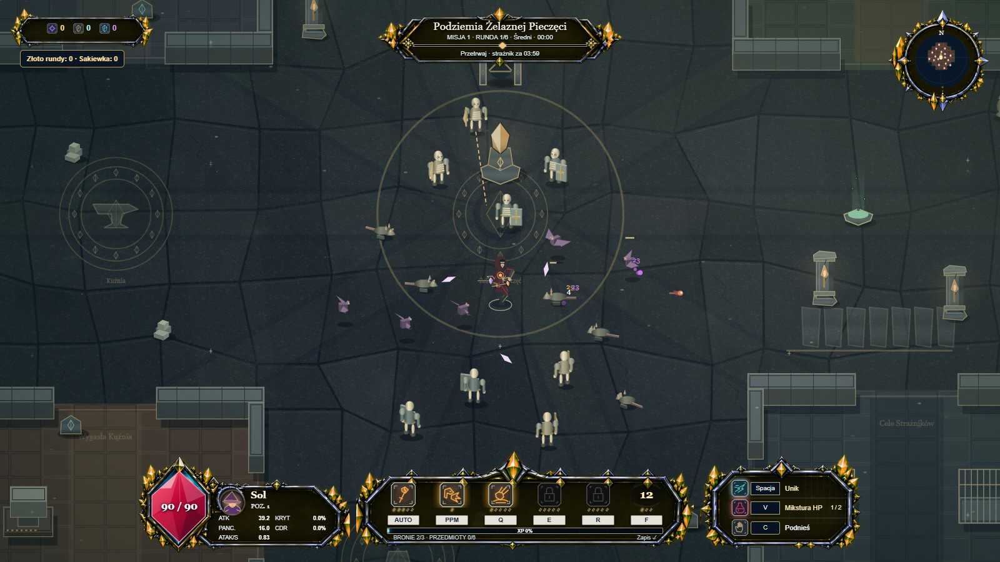

# AEREN · Chronicles of the Abyss

**Dark fantasy • enemy hordes • evolving builds • RIFT**

Choose a hero, survive each round and combine abilities with equipment. Every level brings two choices: an ability upgrade, then an item or weapon. Return to the Sanctuary and prepare your next attempt.

**1.0.0 Release Candidate 2 — English distribution.** A test release, not a final release. New profiles start in English; existing language preferences are preserved.

## Play

- [Download Windows x64](https://github.com/AEREN-game/updates/releases/download/v1.0.0-rc2-en/AEREN-1.0.0-Windows-x64.zip)
- [Website and browser edition](https://aeren-game.github.io/updates/)
- [Packages in this repository](docs/downloads/) — also available before a GitHub Release is created.
- [Installation, controls and saves](PLAYER-GUIDE.md)

The release link requires the v1.0.0-rc2 tag and uploaded ZIPs. Enable GitHub Pages from docs to publish the website.

## Features

- Five heroes: Ilya, Sol, Niva, Orren and Vesper.
- Six world themes: dungeons, ice, forest, fire, the dead and hell.
- 45 catalog abilities and 15 weapons; up to three weapons and six equipment items per run.
- Separate ability and equipment choices, upgrades and synergies.
- Sanctuary, Forge, Keepsakes, run history and challenges.
- RIFT, cursed relics and the choice to descend deeper.
- Shops after rounds, a potion shop, local saves and English/Polish/German settings.

[Changelog](CHANGELOG.md) · [Testing and limitations](TESTING.md) · [Privacy](PRIVACY.md) · [Publishing guide](PUBLISHING.md)

Screenshots show the real RC2 runtime. Combat and reward offers were staged in an isolated profile for the showcase; they do not represent a single continuous run.

This distribution repository contains the website, playable web build and release packages. It does not include the development workspace, private saves or test environment. Browser code is necessarily accessible to the browser. See [THIRD-PARTY-NOTICES.txt](THIRD-PARTY-NOTICES.txt) for component terms. No open-source license has been assigned to the project.
